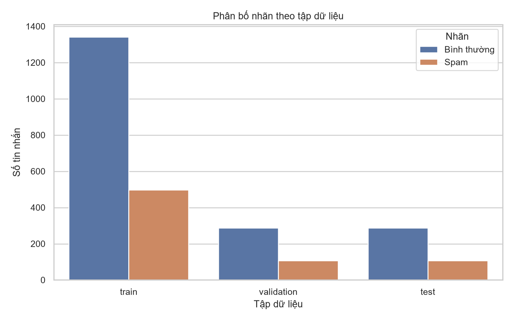
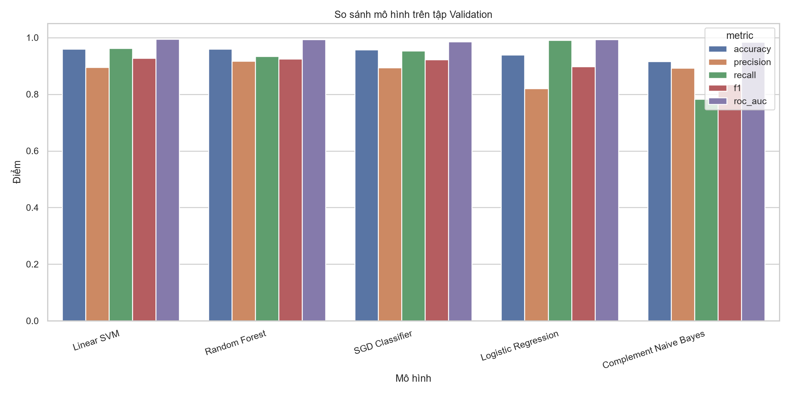
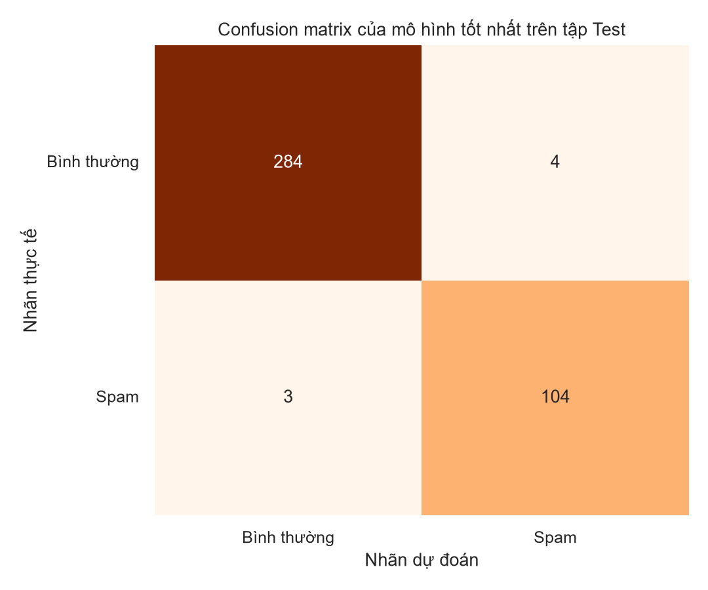

# Kết quả phát hiện spam/lừa đảo

## Phân chia dữ liệu

| Tập | Tổng | Bình thường | Spam | Tỷ lệ spam |
|---|---:|---:|---:|---:|
| train | 1840 | 1342 | 498 | 27.07% |
| validation | 394 | 288 | 106 | 26.90% |
| test | 395 | 288 | 107 | 27.09% |

## So sánh mô hình trên Validation

| Mô hình | Accuracy | Precision | Recall | F1 | ROC-AUC |
|---|---:|---:|---:|---:|---:|
| Linear SVM | 0.9594 | 0.8947 | 0.9623 | 0.9273 | 0.9944 |
| Random Forest | 0.9594 | 0.9167 | 0.9340 | 0.9252 | 0.9934 |
| SGD Classifier | 0.9569 | 0.8938 | 0.9528 | 0.9224 | 0.9851 |
| Logistic Regression | 0.9391 | 0.8203 | 0.9906 | 0.8974 | 0.9926 |
| Complement Naive Bayes | 0.9162 | 0.8925 | 0.7830 | 0.8342 | 0.9837 |

Mô hình được chọn theo F1 Validation: **Linear SVM**.

## Kết quả cuối trên Test

| Chỉ số | Giá trị |
|---|---:|
| accuracy | 0.9823 |
| precision | 0.9630 |
| recall | 0.9720 |
| f1 | 0.9674 |
| roc_auc | 0.9964 |

Tập Test chỉ được dùng sau khi đã chọn mô hình bằng tập Validation.